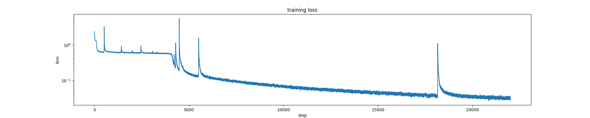
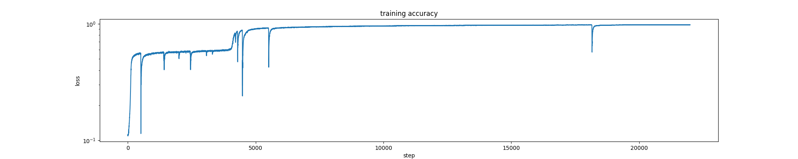
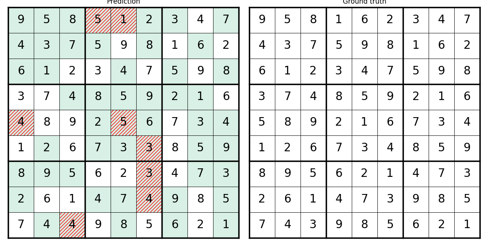

# Sudoku

This example trains a neural network to predict the solution of a 9 x 9 Sudoku
puzzle using PyTorch and the `certen/Sudoku-1M-Puzzles` dataset from Hugging
Face. Two architectures are available: a multilayer perceptron (MLP) and a
transformer. Predictions are learned from examples; neither model explicitly
enforces Sudoku rules, so a predicted board may contain mistakes.

## How it works

Each puzzle contains 81 digits, with `0` representing an empty cell. Each cell
is one-hot encoded as a vector of 10 entries: all entries are zero except the
entry corresponding to its value, which is one. For example, the value `3`
becomes `[0, 0, 0, 1, 0, 0, 0, 0, 0, 0]`. This represents digits as categories
rather than numerical magnitudes.

Both models output nine scores per cell, representing digits 1-9. Training
uses Adam and cross-entropy loss over all cells; reported accuracy measures
only cells that were originally empty.

### MLP (`model_MLP.py`)

The 81 one-hot vectors are flattened into 810 inputs and passed through fully
connected layers with ReLU activations. The last layer produces all 81 x 9
scores at once. The MLP has no built-in notion of rows, columns, or boxes; it
must learn the relationships between all 810 inputs directly.

### Transformer (`model.py`)

Each cell is treated as a token. Its one-hot vector is projected to a
256-dimensional embedding, and a learned position embedding (one per cell) is
added so the model knows where each cell is on the board. The 81 tokens then
pass through a stack of attention blocks. Each block applies, with residual
connections and pre-LayerNorm:

1. single-head self-attention, letting every cell look at every other cell;
2. a feed-forward network (256 -> width -> 256, GELU).

A final linear layer maps each token to nine digit scores. Because attention
compares cells pairwise, this architecture is much better suited to Sudoku
constraints than the MLP (see [Best Hyper-parameters](#best-hyper-parameters)).

In both models, `layer_sizes` sets the depth and width: for the MLP it lists
the hidden layer sizes; for the transformer it has one entry per attention
block, giving that block's feed-forward width.

## Files

| File | Purpose |
| --- | --- |
| `model.py` | Defines the transformer, one-hot encoding, and loss. |
| `model_MLP.py` | Defines the MLP, one-hot encoding, and loss. |
| `train.py` | Loads data, trains and evaluates either model, and saves results. |
| `grid.py` | Grid search over learning rates, block counts, and widths for the transformer. |
| `utils.py` | Plots predictions beside the correct solution. |
| `inference.ipynb` | Loads a saved model and visualizes a prediction. |
| `submit_train.sh`, `submit_grid.sh` | SLURM scripts for `train.py` and `grid.py`. |

## Setup

Run the following commands from this directory (`Sudoku/`):

```bash
python -m venv .venv
source .venv/bin/activate
python -m pip install torch datasets matplotlib wandb jupyterlab
```

The first dataset load requires internet access. Training and grid search
automatically use CUDA when available, otherwise CPU. Full dataset runs can
take substantial time.

## Train

```bash
python train.py                 # transformer (model.py), the default
python train.py --model mlp     # MLP (model_MLP.py)
```

The first 90% of examples are used for training and the remaining 10% for
validation. For both models, defaults are `layer_sizes = [2048] * 4` (four
hidden layers for the MLP, four attention blocks for the transformer), 50
epochs, batch size 2048, and learning rate `0.0002`. This learning rate suits
the transformer; the MLP trains better with `0.001` (see below).

The random seed is fixed at `2026`. Adjust the defaults in `train.py` to change
the training configuration.

Training writes these files in the current directory, replacing existing ones
(`<model>` is `mlp` or `transformer`):

- `sudoku_model_<model>.pt`: model type, layer sizes, and trained weights.
- `training_loss_<model>.png` and `training_accuracy_<model>.png`: training curves.
- `sudoku_prediction_<model>.png`: one validation prediction beside its solution.

The console reports validation loss, empty-cell accuracy, training time, and
GPU memory usage when applicable.

### Training Curves

These curves come from a 4-block transformer run (97.57% validation
accuracy), saved before output names included the model type.





## Compare Configurations

`grid.py` searches over transformer configurations (it imports `model.py`).
`--layers` sets the number of attention blocks and `--widths` their
feed-forward width. Defaults are 8 blocks of width 2048, learning rates
`0.0005` and `0.0002`, 50 epochs, and batch size 2048.

Run a grid search with local output and experiment logging disabled:

```bash
python grid.py --learning-rates 0.0005 0.0002 --layers 4 8 --widths 2048 \
  --epochs 50 --wandb-mode disabled
```

For a quick pipeline check without downloading the dataset:

```bash
python grid.py --synthetic --device cpu --learning-rates 0.001 \
  --layers 1 --widths 32 --epochs 1 --batch-size 32 \
  --wandb-mode disabled --output smoke_results
```

Synthetic grids are random digits and are only useful for checking execution.
Use `--max-train` and `--max-validation` to limit real-data runs, or
`python grid.py --help` to see all options. For online Weights & Biases logging,
run `wandb login` and use `--wandb-mode online`.

## Best Hyper-parameters

Both models were selected by validation empty-cell accuracy (seed `2026`,
900,000 training examples).

| Model | Validation empty-cell accuracy |
| --- | --- |
| MLP | 81.12% |
| Transformer | 99.63% |

### MLP

Found by `grid.py` for the one-hot-input MLP in `model_MLP.py`.

| Hyper-parameter | Value |
| --- | --- |
| Layers | 4 |
| Width | 2048 |
| Learning rate | 0.001 |
| Batch size | 2048 |
| Epochs | 100 |

Validation empty-cell accuracy: 81.12%; test: 80.98% (16.37% of test puzzles
fully solved). A second seed (`2027`) reached 77.08% on validation. The best
epoch was at the 100-epoch limit, so longer training may help.

### Transformer

Found by `grid.py` for the attention model in `model.py` (embedding dimension
256; "width" is the feed-forward hidden size of each attention block). 

| Hyper-parameter | Value |
| --- | --- |
| Attention blocks | 8 |
| Feed-forward width | 2048 |
| Learning rate | 0.0002 |
| Batch size | 2048 |
| Epochs | 50 |

Validation empty-cell accuracy: 99.63%. With 4 blocks, the best result was
98.10% (learning rate 0.0005, 50 epochs). Learning rates of 0.002 or higher
were unstable. Output files from an 8-block training run with `train.py`
(99.62% validation accuracy) are in `layer8/`.

## Inspect Predictions

This prediction comes from the same 4-block transformer run as the training
curves above.



```bash
jupyter lab inference.ipynb
```

Run the notebook cells to load a checkpoint, select a dataset example, and
compare its prediction with the solution. Change `example_index` to view
another puzzle, or `model_path` to load a different checkpoint, such as
`sudoku_model_mlp.pt`, `sudoku_model_transformer.pt` or
`grid_results/best_model.pt`. Green backgrounds mark originally empty cells;
red hatching marks incorrect predictions.

The notebook loads both MLP and transformer checkpoints. It reads the model
type saved by `train.py`; for older checkpoints without it, it detects the
transformer by its attention-block weights.
