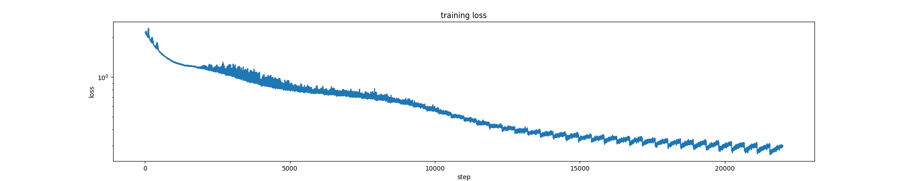
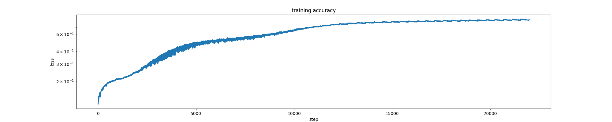

# Sudoku

This example trains a multilayer perceptron (MLP) to predict the solution of a
9 x 9 Sudoku puzzle using PyTorch and the `certen/Sudoku-1M-Puzzles` dataset
from Hugging Face. Predictions are learned from examples; the model does not
explicitly enforce Sudoku rules, so a predicted board may contain mistakes.

## How it works

Each puzzle contains 81 digits, with `0` representing an empty cell. Each cell
is one-hot encoded as a vector of 10 entries: all entries are zero except the
entry corresponding to its value, which is one. For example, the value `3`
becomes `[0, 0, 0, 1, 0, 0, 0, 0, 0, 0]`. This represents digits as categories
rather than numerical magnitudes.

The 81 vectors are flattened into 810 inputs and passed through fully connected
layers with ReLU activations. The output has nine scores per cell, representing
digits 1-9. Training uses Adam and cross-entropy loss over all cells; reported
accuracy measures only cells that were originally empty.

## Files

| File | Purpose |
| --- | --- |
| `model.py` | Defines the MLP, one-hot encoding, and loss. |
| `train.py` | Loads data, trains and evaluates the model, and saves results. |
| `utils.py` | Plots predictions beside the correct solution. |
| `grid.py` | Compares combinations of learning rates, layer counts, and widths. |
| `inference.ipynb` | Loads a saved model and visualizes a prediction. |

## Setup

Run the following commands from this directory (`Sudoku/`):

```bash
python -m venv .venv
source .venv/bin/activate
python -m pip install torch datasets matplotlib wandb jupyterlab
```

The first dataset load requires internet access. Training and grid search
automatically use CUDA when available, otherwise CPU. Full dataset runs can
take substantial time.

## Train

```bash
python train.py                 # transformer (model.py), the default
python train.py --model mlp     # MLP (model_MLP.py)
```

The first 90% of examples are used for training and the remaining 10% for
validation. Defaults are four hidden layers of 2048 units, 50 epochs, batch
size 2048, and learning rate `0.001`.

The random seed is fixed at `2026`. Adjust the defaults in `train.py` to change
the training configuration.

Training writes these files in the current directory, replacing existing ones
(`<model>` is `mlp` or `transformer`):

- `sudoku_model_<model>.pt`: model architecture and trained weights.
- `training_loss_<model>.png` and `training_accuracy_<model>.png`: training curves.
- `sudoku_prediction_<model>.png`: one validation prediction beside its solution.

The console reports validation loss, empty-cell accuracy, training time, and
GPU memory usage when applicable.

### Training Curves





## Compare Configurations

Run a grid search with local output and experiment logging disabled:

```bash
python grid.py --learning-rates 0.0003 0.001 --layers 2 4 --widths 512 \
  --epochs 30 --wandb-mode disabled
```

Results are saved in `grid_results/`, including `results.json`,
`grid_curves.png`, `best_model.pt`, `best_config.json`, and per-trial results
and plots. The winner is selected by validation empty-cell accuracy, with
lower validation loss breaking ties. Use a new `--output` directory for each
run; an existing directory containing `results.json` is rejected.

For a quick pipeline check without downloading the dataset:

```bash
python grid.py --synthetic --device cpu --learning-rates 0.001 \
  --layers 1 --widths 32 --epochs 1 --batch-size 32 \
  --wandb-mode disabled --output smoke_results
```

Synthetic grids are random digits and are only useful for checking execution.
Use `--max-train` and `--max-validation` to limit real-data runs, or
`python grid.py --help` to see all options. For online Weights & Biases logging,
run `wandb login` and use `--wandb-mode online`.

## Best Hyper-parameters

Both models were selected by validation empty-cell accuracy (seed `2026`,
900,000 training examples).

### MLP

Found by `tune.py` (full log in `tuning.txt`) for the one-hot-input MLP in
`model_MLP.py`.

| Hyper-parameter | Value |
| --- | --- |
| Layers | 4 |
| Width | 2048 |
| Learning rate | 0.001 |
| Batch size | 2048 |
| Epochs | 100 |

Validation empty-cell accuracy: 81.12%; test: 80.98% (16.37% of test puzzles
fully solved). A second seed (`2027`) reached 77.08% on validation. The best
epoch was at the 100-epoch limit, so longer training may help.

### Transformer

Found by `grid.py` for the attention model in `model.py` (embedding dimension
256; "width" is the feed-forward hidden size of each attention block). Best
run: `grid_results_26476526`.

| Hyper-parameter | Value |
| --- | --- |
| Attention blocks | 8 |
| Feed-forward width | 2048 |
| Learning rate | 0.0002 |
| Batch size | 2048 |
| Epochs | 45 (best of 50) |

Validation empty-cell accuracy: 99.63%. With 4 blocks, the best result was
98.10% (learning rate 0.0005, 50 epochs). Learning rates of 0.002 or higher
were unstable.

## Inspect Predictions


```bash
jupyter lab inference.ipynb
```

Run the notebook cells to load `sudoku_model.pt`, select a dataset example,
and compare its prediction with the solution. Change `example_index` to view
another puzzle, or `model_path` to load a different checkpoint, such as
`grid_results/best_model.pt`. Green backgrounds mark originally empty cells;
red hatching marks incorrect predictions.
